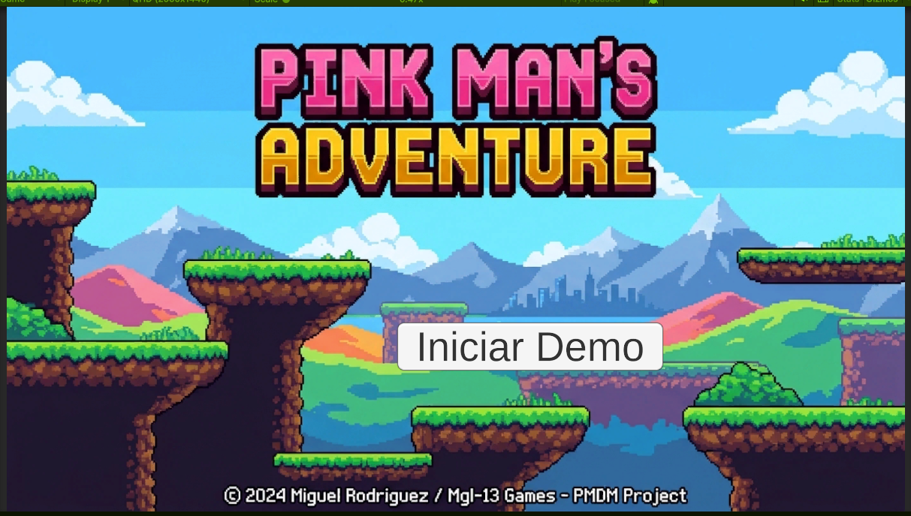
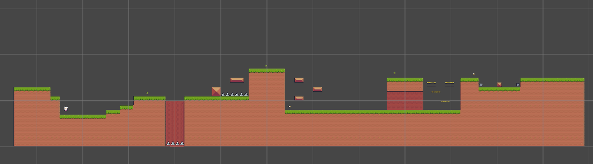

#  Pink Adventures

##  Autor

* **Miguel Rodríguez Fernández** 

---

##  Descripción del Juego

+ Unha demo dun xogo de plataformas básico

### Características principales:
* **Mecánicas do xogador:** Sistema de movimiento horizontal, salto e xestión de vidas con detección de colisiones.
* **Entorno e interactividade:** Niveles construidos con `Tilemaps` e físicas 2D (plataformas sólidas, zonas de perigo/trampas como pinchos e coleccionables).
* **Navegación:** Menú principal con interfaz de usuario (UI Canvas) para iniciar a demo e fluxo de niveles conectado mediante `Build Settings`.

---

##  Capturas de Pantalla

###  Pantalla de Inicio (Menú Principal)

*Menú principal de la demo con el botón para comenzar a jugar.*

---

### Nivel 1

*Vista del primer nivel mostrando las plataformas, el jugador y el mapa inicial.*

---

### Pantalla de Fin / Game Over

*Pantalla mostrada al completar la demo o perder las vidas.*

---

## Tecnologías Utilizadas

* **Motor de juego:** Unity 2D
* **Lenguaje de programación:** C#
* **Assets:** Sprites y tilesets personalizados (*spritesheets*)
